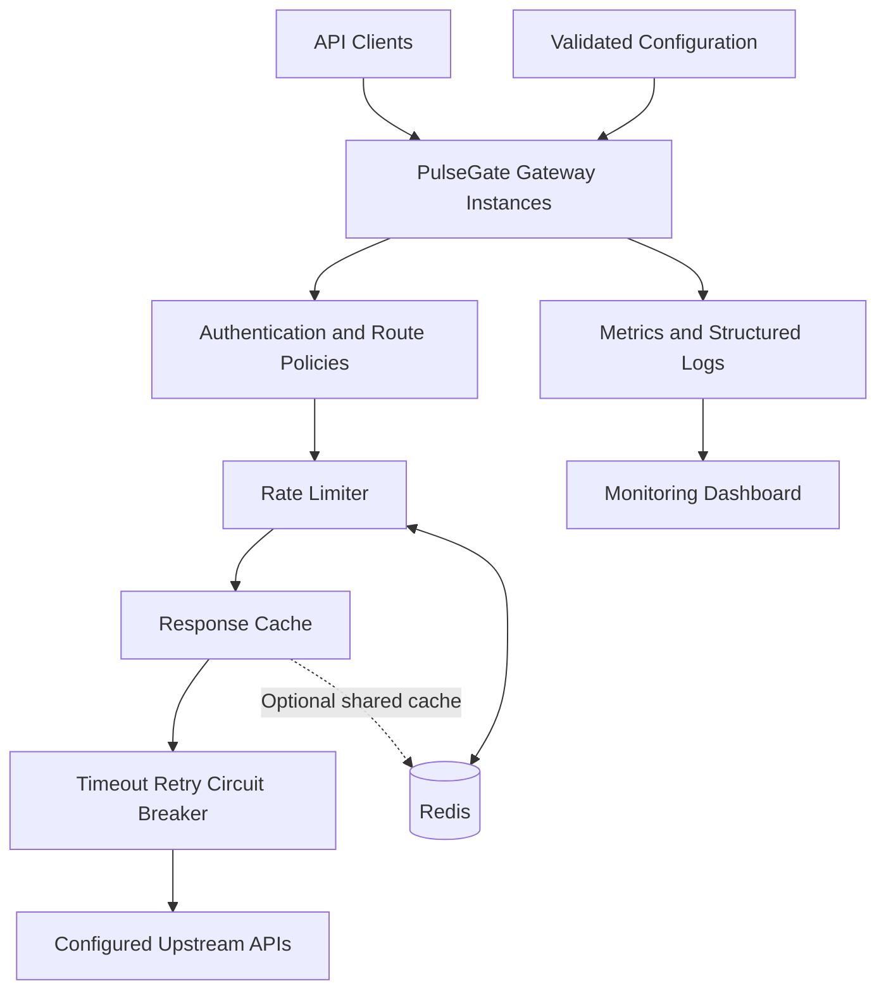
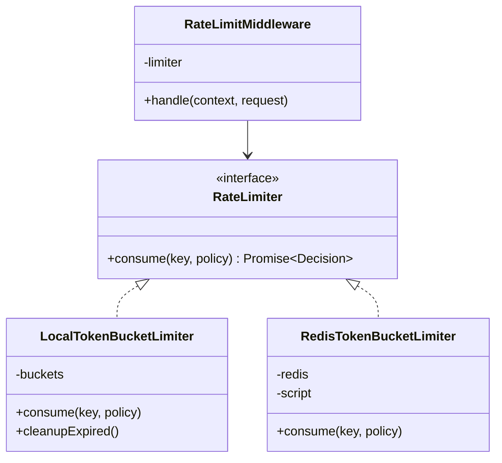
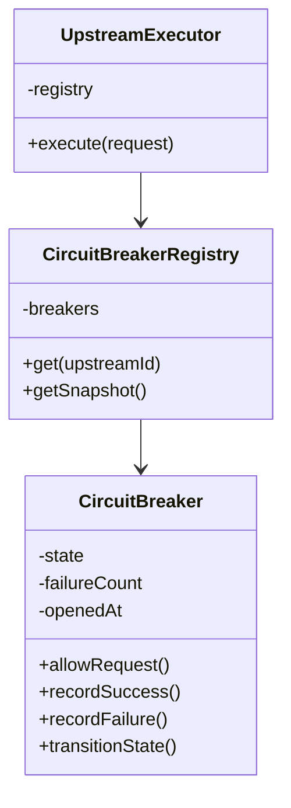
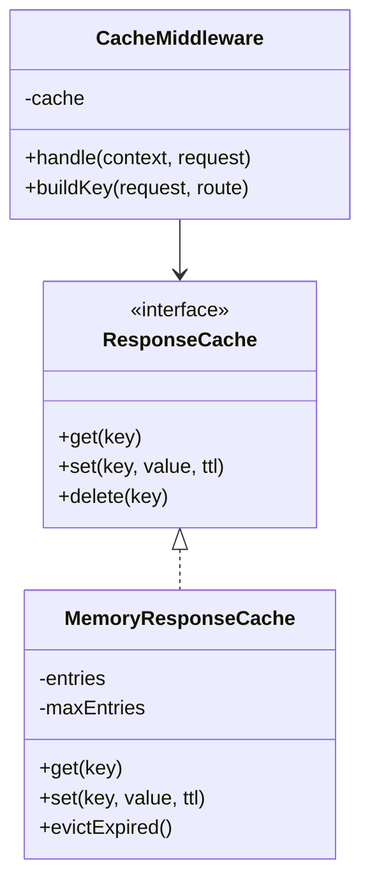

# PulseGate — System Design Specification
## HLD + LLD Addendum to PRD v1.1

## 1. System Design Objectives

PulseGate must demonstrate practical application of:

- **HLD:** service boundaries, architecture, scalability, availability, consistency, caching, fault tolerance, and deployment.
- **LLD:** interfaces, classes, design patterns, concurrency control, state machines, error handling, and testable component contracts.

Every major design decision should have a corresponding architecture diagram, an implementation, and tests validating its behavior.

---

# Part A — High-Level Design (HLD)

## 2. Functional Requirements

The system must:

1. Route HTTP requests to configured upstream services.
2. Authenticate clients and enforce per-client rate limits.
3. Support local and distributed rate limiting.
4. Cache eligible responses.
5. Apply request timeouts, bounded retries, and circuit breakers.
6. Expose health endpoints, metrics, and request logs.
7. Support horizontally scaled gateway instances.
8. Provide a dashboard for monitoring traffic and service health.

## 3. Non-Functional Requirements

- **Availability:** A failing upstream must not crash the gateway or unrelated upstream routes.
- **Latency:** Gateway overhead must be measured against a direct-upstream baseline.
- **Scalability:** Stateless gateway instances should be horizontally scalable.
- **Consistency:** Redis-backed rate limits should share an atomic token budget across gateway instances.
- **Fault tolerance:** Timeouts, retry budgets, and circuit breakers should bound failure propagation.
- **Security:** API keys, administrative endpoints, and cached data must be protected.
- **Observability:** Traffic, latency, errors, and policy decisions must be measurable.
- **Maintainability:** Components must be independently testable and replaceable through interfaces.

## 4. HLD Component Architecture



### Component responsibilities

| Component | Responsibility |
|---|---|
| Gateway | Accept, validate, route, and forward HTTP requests |
| Authentication | Resolve client identity and validate API keys |
| Rate limiter | Enforce token budgets locally or through Redis |
| Cache | Store eligible responses with safe cache keys and TTLs |
| Reliability engine | Apply timeouts, retries, and circuit-breaker policies |
| Configuration registry | Validate and resolve routes, upstreams, and policies |
| Observability | Record latency, outcomes, errors, and policy activity |
| Dashboard | Visualize aggregate gateway health and performance |

## 5. Scalability and Capacity Planning

### Horizontal scaling

Run multiple gateway instances behind a load balancer. Each instance handles requests independently, while Redis coordinates shared rate-limit state.

The gateway should not rely on sticky sessions for correctness.

### Rate-limiting consistency

- Local mode maintains independent token buckets per instance.
- Distributed mode executes token consumption atomically in Redis.
- Redis outages follow an explicitly configured fail-open or fail-closed policy.
- The project must document the trade-off between availability and strict enforcement.

### Caching strategy

Begin with a bounded in-memory cache. Evaluate Redis-backed caching separately if cross-instance cache sharing becomes necessary.

Measure cache hit ratio, memory usage, and p95/p99 latency before introducing additional complexity.

### Backpressure and resource limits

- Limit concurrent upstream requests where appropriate.
- Enforce request and response size limits.
- Bound retries and in-memory state.
- Apply timeouts to network operations.
- Reject excess traffic instead of allowing unbounded resource consumption.

## 6. Reliability and Failure Scenarios

| Failure | Expected behavior |
|---|---|
| Upstream is slow | Enforce timeout and return a normalized gateway error |
| Upstream repeatedly fails | Open the circuit and stop forwarding requests temporarily |
| Redis is unavailable | Apply configured rate-limiter failure policy |
| Cache entry expires | Fetch from upstream and refresh if eligible |
| One gateway instance crashes | Other instances continue serving traffic, subject to shared dependencies |
| Configuration is invalid | Fail startup with an actionable validation error |
| Retry attempts are exhausted | Return the final normalized error and record the failure |

### Consistency boundaries

- Redis token-bucket updates are atomic.
- Local cache entries are instance-specific.
- Circuit-breaker state is instance-specific in the MVP.
- Route configuration is validated at startup and remains static during initial operation.

Distributed circuit-breaker coordination and dynamic configuration are optional future extensions, not MVP guarantees.

## 7. HLD Trade-Offs to Document

Create Architecture Decision Records (ADRs) for:

1. Why a modular monolith instead of microservices.
2. Why in-memory token buckets are useful for the baseline.
3. Why Redis Lua scripts are used for atomic distributed rate limiting.
4. Why PostgreSQL is not on the request-processing hot path.
5. Why retries are bounded and restricted by request semantics.
6. Why circuit breakers are scoped per upstream.
7. Why caching defaults are conservative.
8. When to introduce shared caching or distributed breaker state.

---

# Part B — Low-Level Design (LLD)

## 8. Core Interfaces

### Gateway request context

```ts
interface GatewayRequestContext {
  requestId: string;
  routeId: string;
  clientId?: string;
  startedAtMs: number;
  deadlineAtMs: number;
}
```

This context carries trusted request metadata through the middleware pipeline. Client identity must be assigned only after successful authentication.

### Route configuration

```ts
interface RouteConfig {
  id: string;
  pathPrefix: string;
  methods: string[];
  upstreamId: string;
  authRequired: boolean;
  timeoutMs: number;
  retries: {
    maxAttempts: number;
  };
  rateLimit: {
    capacity: number;
    refillRatePerSecond: number;
  };
  cache: {
    enabled: boolean;
    ttlSeconds: number;
    maxResponseBytes: number;
  };
}
```

Runtime validation should use Zod, with TypeScript types inferred from the schema.

## 9. Rate Limiter Class Design



### Design pattern: Strategy

Both implementations satisfy the same `RateLimiter` interface.

The application selects the implementation from validated configuration, without changing the middleware that consumes rate-limit decisions.

### Token-bucket algorithm

For elapsed time \(\Delta t\), capacity \(C\), refill rate \(r\), and previous balance \(T\):

\[
T'=\min(C,T+r\Delta t)
\]

If \(T'\geq1\), consume one token; otherwise reject the request.

The local implementation uses bounded in-memory state. The Redis implementation performs read, refill, decision, decrement, and expiry updates atomically through a Lua script.

## 10. Circuit Breaker Class Design



### Design pattern: State

The breaker explicitly implements `CLOSED`, `OPEN`, and `HALF_OPEN` states.

State transitions must be centralized so that:
- Only permitted requests pass through.
- Recovery probes are bounded.
- Success and failure counters are updated consistently.
- Every transition can be tested and observed.

The breaker registry creates or retrieves a breaker per configured upstream.

## 11. Retry and Timeout Design

```ts
interface RetryPolicy {
  maxAttempts: number;
  baseDelayMs: number;
  maxDelayMs: number;
  retryableStatuses: number[];
}

interface UpstreamExecutor {
  execute(
    request: Request,
    context: GatewayRequestContext
  ): Promise<Response>;
}
```

The upstream executor:
1. Checks the circuit breaker.
2. Computes the remaining request deadline.
3. Executes the upstream request.
4. Classifies the result.
5. Retries only eligible failures within the remaining deadline.
6. Records the final result for breaker and observability logic.

Use exponential backoff with jitter and explicit cancellation. Ensure that retries do not exceed the total deadline or repeat unsafe operations.

## 12. Cache Class Design



### Design pattern: Strategy

The cache interface allows the storage implementation to change without rewriting the gateway middleware.

The initial cache must enforce:
- TTL expiry.
- Bounded storage.
- Maximum response size.
- Safe eligibility rules.
- Client and representation isolation.

A Redis cache can later implement the same interface, with explicitly documented consistency and invalidation semantics.

## 13. Middleware Composition

Use a single composition layer to define request order:

```ts
const pipeline = [
  requestValidation,
  routeMatching,
  authentication,
  rateLimiting,
  cacheLookup,
  circuitBreakerCheck,
  upstreamExecution,
  cacheWrite,
  observation
];
```

This is a conceptual ordering, not a requirement to implement every stage as a mutable middleware array. The actual implementation should use typed Fastify hooks and explicit service calls where that makes control flow easier to reason about.

The design must guarantee:
- Authentication precedes client-specific rate limiting.
- Rate limiting precedes cache lookup.
- Cache hits avoid unnecessary upstream execution.
- Retries and timeouts remain inside the upstream execution boundary.
- All exits produce appropriate metrics and cleanup.

## 14. Error Handling Design

Define typed internal errors rather than scattering raw status codes throughout the application.

```ts
type GatewayErrorCode =
  | "ROUTE_NOT_FOUND"
  | "AUTHENTICATION_FAILED"
  | "RATE_LIMIT_EXCEEDED"
  | "CIRCUIT_OPEN"
  | "UPSTREAM_TIMEOUT"
  | "UPSTREAM_UNAVAILABLE"
  | "INTERNAL_ERROR";
```

Each error should include a stable code, an appropriate HTTP status, and a request ID. Internal diagnostics belong in structured logs; sensitive implementation details must not be returned to clients.

## 15. Testing Strategy for LLD

Every core component should have isolated tests.

| Component | Essential tests |
|---|---|
| Token bucket | Refill, consume, reject, concurrent access, expiry |
| Redis limiter | Atomicity, shared budgets, connection failure, policy behavior |
| Circuit breaker | State transitions, probe limits, recovery |
| Retry executor | Attempt budgets, backoff, deadlines, idempotency restrictions |
| Response cache | TTL, key isolation, size limits, bypass rules |
| Route registry | Schema validation, route matching, unknown upstream |
| Middleware pipeline | Correct ordering, early exits, cleanup |
| Observability | Correct counters, bounded labels, secret redaction |

Use fake clocks and deterministic test doubles for unit tests. Use real Redis in integration tests where atomicity and multi-instance behavior must be validated.

---

# Part C — System Design Deliverables

## 16. Required Design Artifacts

Before the final release, the repository should contain:

1. **HLD diagram:** Gateway, Redis, upstreams, configuration, and observability.
2. **LLD class diagrams:** Rate limiter, circuit breaker, cache, and upstream executor.
3. **Sequence diagram:** Normal request, rate-limit rejection, cache hit, and upstream failure.
4. **State diagram:** Circuit-breaker transitions.
5. **ER diagram:** Optional persistent control-plane schema.
6. **API contract:** Gateway, health, metrics, and administrative endpoints.
7. **ADRs:** Major design decisions and their trade-offs.
8. **Benchmark report:** Reproducible latency, throughput, and failure tests.
9. **Failure-mode document:** Expected behavior during Redis, cache, and upstream outages.

## 17. Interview Readiness Criteria

PulseGate should let you explain and defend:

- Why the gateway is a modular monolith initially.
- How token-bucket rate limiting works under concurrent requests.
- Why Redis operations need atomic execution.
- Why local and distributed rate limiting have different semantics.
- How retries can amplify an outage.
- How circuit breakers prevent repeated calls to unhealthy services.
- How caching changes latency and consistency.
- How to avoid cache-key collisions and data leakage.
- How to scale gateway instances horizontally.
- How to measure throughput and p95/p99 latency.
- What happens when Redis or an upstream becomes unavailable.
- Which design decisions would change at substantially higher traffic.

**Definition of success:** Every major HLD concept should have a corresponding LLD component, and every LLD component should have tests demonstrating its correctness and failure behavior.