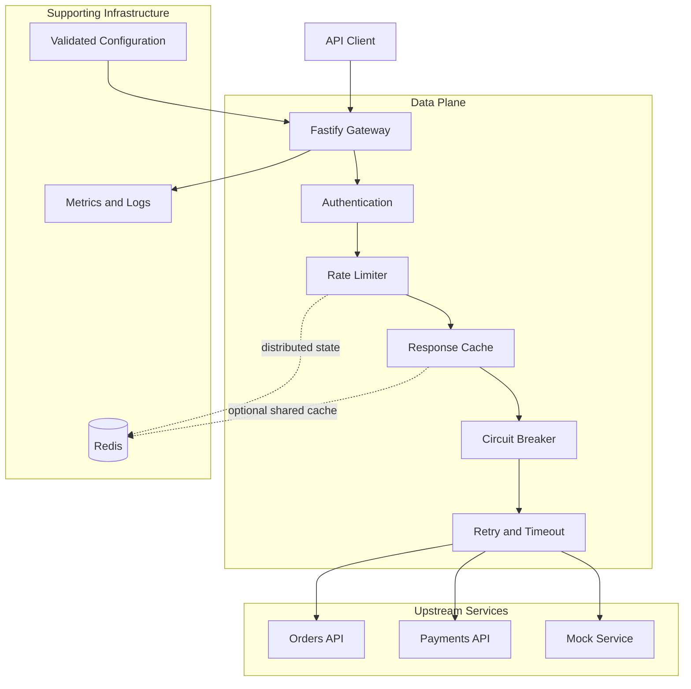

# PulseGate
## Technical Architecture & Implementation Plan

**Version:** 1.0  
**Status:** Architecture baseline  
**Implementation style:** TypeScript monorepo, modular backend, independently testable components  
**Release goal:** Public open-source repository, Docker deployment, live demo, reproducible benchmarks

---

# 1. Architecture Decisions

| Decision | Selected approach | Rationale |
|---|---|---|
| Runtime | Node.js + TypeScript | Strong HTTP ecosystem and type safety |
| Gateway HTTP server | Fastify | Lightweight routing, validation, and lifecycle hooks |
| HTTP forwarding | Undici | Explicit control over upstream requests and timeouts |
| Local rate limiter | In-memory token bucket | Low-latency baseline without external dependencies |
| Distributed rate limiter | Redis + atomic Lua script | Shared token state across gateway instances |
| Redis client | ioredis | Connection pooling and Redis integration |
| Configuration | Zod-validated YAML/JSON | Type-safe, reproducible configuration |
| Metrics | Prometheus-compatible endpoint | Standard observability integration |
| Dashboard | React + TypeScript | Visual traffic and policy monitoring |
| Persistence | PostgreSQL in a later control-plane phase | Durable API clients and configuration management |
| Testing | Vitest + Fastify injection + integration tests | Fast feedback and deterministic testing |
| Load testing | k6 | Repeatable throughput and latency measurements |
| Deployment | Docker Compose | Reproducible local and demonstration environments |

**Architecture principle:** The request-processing path should not depend on PostgreSQL. PostgreSQL will be used only when durable management of API clients, configuration, or audit records is needed. Redis is optional for single-instance mode but required for shared distributed rate limiting.

# 2. High-Level System Architecture



This is a logical diagram. The first implementation can run as a single gateway process with Redis and mock upstreams in Docker Compose.

## 2.1 Component boundaries

### A. Gateway server

Responsibilities:
- Accept HTTP requests.
- Match configured routes.
- Execute the request middleware pipeline.
- Forward requests to upstream services.
- Normalize gateway-generated errors.
- Shut down gracefully.

It must not contain the implementation details of Redis rate limiting, cache storage, or circuit-breaker algorithms.

### B. Route registry

Responsibilities:
- Load and validate route configuration at startup.
- Match the incoming HTTP method and path.
- Resolve the target upstream.
- Associate a route with its authentication, caching, and reliability policies.

Initial route configuration is read-only at runtime. Hot reload and database-backed configuration can be added later.

### C. Authentication service

Responsibilities:
- Extract API credentials from the configured header.
- Validate the credential against a configured client.
- Produce a trusted client identity.
- Reject invalid requests before forwarding them.
- Redact secrets from all logs.

For the MVP, API keys can be configured in a secrets file or environment variables. Store only a cryptographic hash when persistent key management is introduced.

### D. Rate-limiting service

Responsibilities:
- Apply a token-bucket policy to each identified client and route.
- Support local and Redis-backed implementations behind the same interface.
- Return an explicit allow/deny decision and remaining capacity.
- Fail according to a configurable Redis failure policy.

### E. Cache service

Responsibilities:
- Determine whether a request is eligible for caching.
- Generate a deterministic cache key.
- Read and write cached responses.
- Enforce TTL and response-size limits.
- Track hits, misses, and evictions.

Start with a bounded in-memory cache. Shared Redis caching is an optional extension, separate from the requirement for distributed rate limiting.

### F. Reliability engine

Responsibilities:
- Apply request timeouts.
- Retry eligible requests within a fixed attempt budget.
- Maintain circuit-breaker state per upstream.
- Stop forwarding traffic to an open circuit.
- Track failure and recovery transitions.

Retries and circuit breakers must be independently testable.

### G. Observability service

Responsibilities:
- Emit structured request logs.
- Record latency and outcome metrics.
- Track rate-limit decisions, cache activity, retries, and breaker transitions.
- Expose metrics without storing sensitive request data.

### H. Control plane and dashboard

Responsibilities:
- Display gateway health and aggregate traffic.
- Show latency, errors, cache performance, and rate-limit activity.
- Inspect configured routes and policies.
- Protect administrative operations.

The MVP dashboard reads metrics from the gateway. Durable route management and API-key CRUD are later additions, not prerequisites for the first release.

# 3. Monorepo Structure

Use pnpm workspaces to keep the codebase modular without splitting it into independently deployed microservices prematurely.

```text
pulsegate/
├── apps/
│   ├── gateway/
│   │   └── src/
│   │       ├── server.ts
│   │       ├── app.ts
│   │       ├── proxy/
│   │       ├── middleware/
│   │       ├── routes/
│   │       └── plugins/
│   └── dashboard/
│       └── src/
│           ├── pages/
│           ├── components/
│           ├── api/
│           └── charts/
├── packages/
│   ├── config/
│   │   ├── schema.ts
│   │   └── loader.ts
│   ├── rate-limiter/
│   │   ├── token-bucket.ts
│   │   ├── local-store.ts
│   │   ├── redis-store.ts
│   │   └── redis-script.ts
│   ├── cache/
│   ├── reliability/
│   │   ├── circuit-breaker.ts
│   │   ├── retry.ts
│   │   └── timeout.ts
│   ├── observability/
│   ├── shared/
│   │   ├── errors.ts
│   │   └── types.ts
│   └── testing/
├── examples/
│   └── mock-upstreams/
├── config/
│   └── routes.example.yaml
├── tests/
│   ├── integration/
│   └── e2e/
├── benchmarks/
│   ├── k6/
│   └── reports/
├── docker-compose.yml
├── pnpm-workspace.yaml
├── package.json
├── .env.example
├── README.md
└── LICENSE
```

Each package should expose a small public interface. The gateway composes these interfaces instead of directly importing internal implementation details.

# 4. Request Lifecycle

The request lifecycle is the central design contract of PulseGate.

## 4.1 Normal request

1. **Receive request:** Assign a request ID and record the start time.
2. **Validate request:** Apply HTTP parsing limits and reject malformed input.
3. **Match route:** Resolve the route and upstream.
4. **Authenticate:** Identify the API client and reject invalid credentials.
5. **Apply rate limiting:** Consume a token from the client's bucket.
6. **Check cache:** Return an eligible cached response if present.
7. **Check circuit breaker:** Reject requests if the upstream circuit is open.
8. **Forward request:** Apply timeout and retry policies around the upstream call.
9. **Update cache:** Store an eligible response using the configured TTL.
10. **Record outcome:** Emit metrics and structured logs.
11. **Return response:** Send the upstream response or a normalized gateway error.

The ordering matters. Authentication precedes client-specific rate limiting, and rate limiting precedes cache lookup so cached responses do not bypass traffic policies. Circuit-breaker evaluation occurs only when an upstream request is necessary.

## 4.2 Error handling

| Condition | HTTP response | Internal behavior |
|---|---|---|
| Unknown route | 404 | Do not contact an upstream |
| Invalid API key | 401 | Do not forward the request |
| Rate limit exceeded | 429 | Return retry information where applicable |
| Circuit open | 503 | Do not contact the upstream |
| Upstream timeout | 504 | Stop work within the request deadline |
| Upstream connection failure | 502 | Record failure and update breaker state |
| Invalid gateway configuration | Startup failure | Fail fast with actionable diagnostics |
| Redis unavailable | Policy-dependent | Follow configured fail-open or fail-closed behavior |

Gateway errors should use a consistent JSON structure, with internal stack traces excluded from public responses.

Example:

```json
{
  "error": {
    "code": "RATE_LIMIT_EXCEEDED",
    "message": "Request limit exceeded",
    "requestId": "req_example"
  }
}
```

## 4.3 Retry safety

Retries are allowed only within a bounded deadline and attempt budget.

- Retry transient failures such as connection errors and selected upstream status codes.
- Do not automatically retry non-idempotent operations unless an explicit idempotency mechanism makes the operation safe.
- Use exponential backoff with jitter.
- Release resources after success, failure, or cancellation.
- Count only the final client-visible result as one gateway request, while separately recording upstream attempts.

# 5. Rate Limiting Design

PulseGate will provide two implementations of the same `RateLimiter` interface.

## 5.1 Shared interface

```ts
export interface RateLimitPolicy {
  capacity: number;
  refillRatePerSecond: number;
}

export interface RateLimitDecision {
  allowed: boolean;
  remaining: number;
  retryAfterMs: number;
}

export interface RateLimiter {
  consume(
    key: string,
    policy: RateLimitPolicy
  ): Promise<RateLimitDecision>;
}
```

The interface deliberately hides storage details. Gateway middleware should not need to know whether a decision comes from memory or Redis.

## 5.2 Local token bucket

Each key has:
- Current token balance.
- Last-refill timestamp.
- Configured capacity and refill rate.

For elapsed time \(\Delta t\):

\[
T_{\text{new}} =
\min(C,\ T_{\text{old}} + r\Delta t)
\]

Where \(C\) is bucket capacity and \(r\) is the refill rate.

A request is allowed if at least one token is available; the bucket then consumes one token.

Implementation requirements:
- Use a monotonic clock for elapsed-time calculations where possible.
- Make token refill and consumption atomic within the JavaScript execution model.
- Bound the number of stored keys.
- Evict expired idle buckets.
- Test behavior with an injected clock rather than relying on sleeps.

Local mode is fast, but each gateway instance maintains separate state. It is not a global rate limit.

## 5.3 Redis-backed token bucket

The Redis implementation uses a single Lua script to:
1. Read the bucket state.
2. Calculate token refill.
3. Decide whether the request is allowed.
4. Deduct a token when permitted.
5. Update bucket state and expiry.
6. Return the decision and remaining capacity.

These operations must execute atomically to prevent concurrent requests from consuming the same token.

Recommended key format:

```text
pulsegate:rl:v1:{clientId:routeId}
```

The exact encoding must prevent ambiguous key construction. Redis Cluster hash tags may be used when relevant.

The Redis script should use Redis server time for shared calculations to avoid inconsistent clocks across gateway instances. Key expiry should be derived from the time needed for a bucket to refill or another documented bounded idle-retention rule.

## 5.4 Redis failure policy

Support two explicit modes:

- **Fail-closed:** Reject requests when a distributed rate-limit decision cannot be obtained. This prioritizes enforcing limits.
- **Fail-open:** Allow requests when the limiter is unavailable. This prioritizes availability but may permit excess traffic.

Neither policy is universally correct. The configuration must be explicit, observable, and documented. The live demo should not silently switch policies.

# 6. Circuit Breaker Design

Each upstream has an independent breaker.

### States

- **Closed:** Requests are permitted; failures are counted.
- **Open:** Requests are rejected immediately.
- **Half-open:** A limited number of probe requests test recovery.

### Configuration

```yaml
circuitBreaker:
  failureThreshold: 5
  openDurationMs: 10000
  halfOpenMaxRequests: 1
```

### State transitions

- Closed → Open when the configured failure threshold is reached.
- Open → Half-open after the open interval expires.
- Half-open → Closed after the required successful probes.
- Half-open → Open when a probe fails.

Failure classification must be configurable. Client errors such as ordinary 4xx responses should not automatically count as upstream availability failures.

The MVP can maintain breaker state in memory. Distributed breaker coordination can be evaluated later; it should not be claimed as a capability of the initial implementation.

# 7. Caching Design

## 7.1 Initial policy

Cache only explicitly eligible responses. Begin with GET requests and successful responses, and enforce response-size limits and TTLs.

Default behavior:
- Do not cache requests with authorization headers unless an explicit safe policy allows it.
- Do not cache responses marked private or no-store.
- Respect documented cache-control behavior.
- Avoid caching personalized responses under a shared key.
- Exclude sensitive headers from cached metadata.

## 7.2 Cache key

A cache key should incorporate:
- Route identity.
- HTTP method.
- Normalized path.
- Relevant query parameters.
- Any explicitly configured representation headers.

Do not include raw credentials in the key. Cache partitioning must be correct for client-specific data.

## 7.3 MVP cache implementation

Use a bounded in-memory cache with TTL and maximum response-size limits. Track hit, miss, eviction, and expiration counters.

Redis-backed shared caching is optional P1 work. Implement it only after the local cache has clear tests and benchmark evidence.

# 8. Configuration Contract

Example route configuration:

```yaml
server:
  host: "0.0.0.0"
  port: 8080

rateLimit:
  mode: "local"
  redisFailurePolicy: "closed"

routes:
  - id: "orders"
    pathPrefix: "/api/orders"
    methods: ["GET", "POST"]
    upstream: "http://orders-mock:4001"
    auth:
      required: true
    rateLimit:
      capacity: 60
      refillRatePerSecond: 1
    timeoutMs: 3000
    retries:
      maxAttempts: 2
    cache:
      enabled: true
      ttlSeconds: 30
      maxResponseBytes: 262144

upstreams:
  - id: "orders-service"
    baseUrl: "http://orders-mock:4001"
```

The final schema must define how route IDs resolve to upstream IDs, how prefixes are stripped or preserved, how query strings are forwarded, and how methods are matched. Configuration should be validated before the server accepts traffic.

For public deployments, upstream targets must be explicitly configured and validated. Arbitrary user-supplied upstream URLs would create server-side request forgery risks.

# 9. API Contracts

PulseGate exposes three API surfaces: the gateway data plane, the management/observability API, and health endpoints.

## 9.1 Gateway API

The gateway forwards configured paths such as:

```http
GET /api/orders/123
X-API-Key: <client-api-key>
```

The gateway authenticates the client, applies its policies, and forwards the request to the configured orders service.

Relevant response headers may include:

```http
X-Request-ID: req_example
X-RateLimit-Limit: 60
X-RateLimit-Remaining: 12
```

Rate-limit header names and semantics must be documented consistently. Do not expose internal credentials or upstream connection details.

## 9.2 Health API

| Endpoint | Purpose |
|---|---|
| `GET /health` | Process liveness |
| `GET /ready` | Readiness, including required dependency status |
| `GET /metrics` | Prometheus-format metrics |

Liveness should not fail merely because Redis is temporarily unavailable. Readiness may reflect Redis availability when distributed mode is configured to require it.

## 9.3 Management API

Management endpoints are separate from public gateway routes and require administrative authorization.

| Method and endpoint | Purpose |
|---|---|
| `GET /admin/routes` | Inspect active routes |
| `GET /admin/stats` | Retrieve aggregate metrics |
| `GET /admin/upstreams` | Inspect upstream health and breaker state |
| `GET /admin/rate-limits` | Inspect configured policies |
| `GET /admin/cache/stats` | Retrieve cache counters |

The first release may serve read-only information from in-memory configuration and metrics. Persistent route editing, API-key CRUD, and audit history require a separate control-plane implementation.

## 9.4 Management error format

Use the same normalized error schema as the gateway. Validate request parameters and pagination, limit response sizes, and avoid exposing secrets.

# 10. Data Models

The data plane needs only a small set of runtime models.

## 10.1 Route configuration

```ts
interface RouteConfig {
  id: string;
  pathPrefix: string;
  methods: string[];
  upstreamId: string;
  auth: {
    required: boolean;
  };
  rateLimit: {
    capacity: number;
    refillRatePerSecond: number;
  };
  timeoutMs: number;
  retries: {
    maxAttempts: number;
  };
  cache: {
    enabled: boolean;
    ttlSeconds: number;
    maxResponseBytes: number;
  };
}
```

This is an illustrative contract; Zod should be the runtime source of truth and TypeScript types should be inferred from its schema.

## 10.2 API client

```ts
interface ApiClient {
  id: string;
  keyHash: string;
  name: string;
  enabled: boolean;
  createdAt: string;
}
```

For the MVP, clients can be loaded from secrets-backed configuration. Persistent management is a later phase.

## 10.3 Rate-limit state

Local state:

```ts
interface TokenBucketState {
  tokens: number;
  lastRefillMs: number;
}
```

Redis state stores equivalent values with an atomic update and bounded expiry. The key identifies a client and route policy; the raw API key is never used as the identifier.

## 10.4 Circuit-breaker state

```ts
type BreakerStatus = "closed" | "open" | "half-open";

interface CircuitBreakerState {
  status: BreakerStatus;
  failureCount: number;
  openedAtMs?: number;
  halfOpenInFlight: number;
}
```

This state is local to each upstream in the initial release.

## 10.5 Request observation

```ts
interface RequestObservation {
  requestId: string;
  routeId: string;
  clientId?: string;
  method: string;
  statusCode: number;
  durationMs: number;
  cacheStatus: "hit" | "miss" | "bypass";
  retryCount: number;
  timestamp: string;
}
```

Request observations should be emitted as logs or metrics events. High-volume raw request history should not be stored in PostgreSQL by default.

## 10.6 Optional persistent control-plane schema

When durable management is introduced, use PostgreSQL tables such as:

- `api_clients`: client identity, key hash, status, creation time.
- `routes`: route configuration and enabled state.
- `policies`: rate-limit, cache, timeout, and retry settings.
- `audit_events`: administrative changes and actor metadata.

Use migrations and transactional updates. Do not store live per-request token-bucket state in PostgreSQL.

# 11. Observability Specification

Metrics should use bounded labels to avoid unbounded cardinality.

Recommended metrics:

```text
pulsegate_requests_total
pulsegate_request_duration_seconds
pulsegate_upstream_requests_total
pulsegate_upstream_duration_seconds
pulsegate_rate_limit_decisions_total
pulsegate_cache_requests_total
pulsegate_retries_total
pulsegate_circuit_breaker_transitions_total
pulsegate_active_requests
```

Use labels such as route ID, status class, outcome, and cache result. Never use API keys, request IDs, raw URLs containing arbitrary identifiers, or user-provided values as Prometheus labels.

The dashboard should initially show:
- Total request volume.
- Success and error rates.
- p50/p95/p99 latency.
- Rate-limit rejections.
- Cache hit ratio.
- Upstream health and breaker states.

# 12. Security Requirements

1. Never commit API keys, Redis passwords, or deployment secrets.
2. Redact authorization headers and sensitive query parameters.
3. Protect management endpoints independently of client authentication.
4. Restrict upstream destinations to configured targets.
5. Set maximum request and response sizes.
6. Prevent unbounded retries and uncontrolled in-memory state growth.
7. Validate configuration at startup.
8. Avoid caching private or personalized responses by default.
9. Apply safe shutdown and connection cleanup.
10. Document TLS termination and trusted-proxy assumptions.

The public demo should use mock upstreams and synthetic traffic. It should not accept arbitrary upstream URLs or expose an unauthenticated administrative interface.

# 13. Testing Strategy

## Unit tests

**Rate limiter**
- Initial bucket capacity.
- Refill over elapsed time.
- Token consumption.
- Rejection when empty.
- Concurrent calls against the same bucket.
- Bucket expiration and cleanup.
- Redis Lua atomicity under concurrent requests.

**Circuit breaker**
- Closed-to-open transition.
- Open-state rejection.
- Half-open recovery.
- Failed recovery probe.
- Concurrent half-open request limits.

**Retry and timeout**
- Maximum attempt count.
- Backoff and jitter bounds.
- Request deadline enforcement.
- No unsafe retry of non-idempotent requests by default.
- Cancellation and resource cleanup.

**Cache**
- Cache-key correctness.
- TTL expiry.
- Cache bypass rules.
- Authorization isolation.
- Maximum response size.
- Concurrent requests for the same cache key.

## Integration tests

Use real Redis in a test container to verify distributed rate limiting. Use mock upstream servers that can simulate delays, connection resets, 4xx/5xx responses, and recovery.

Test:
- Two gateway instances sharing one Redis rate-limit budget.
- Redis outage behavior for each configured failure policy.
- Circuit-breaker isolation across upstreams.
- Cache behavior across client identities.
- Correct forwarding of headers, query parameters, methods, and response bodies.

## End-to-end tests

Start the full stack using Docker Compose and exercise:
- Valid and invalid API keys.
- Allowed and rejected traffic.
- Cache hits and misses.
- Upstream timeouts.
- Circuit-breaker opening and recovery.
- Dashboard metrics.
- Readiness and graceful shutdown.

## Performance tests

Run controlled k6 workloads against:
1. A baseline mock upstream.
2. The gateway without optional policies.
3. The gateway with local rate limiting.
4. The gateway with Redis-backed rate limiting.
5. Cache-hit and cache-miss scenarios.
6. An upstream with injected latency and failures.

Record requests per second, p50/p95/p99 latency, error rate, CPU, memory, and policy correctness. Document the hardware and software versions for every published result.

# 14. Implementation Roadmap

## Phase 1 — Gateway foundation

Deliverables:
- TypeScript monorepo and lint/test/build scripts.
- Fastify server and route registry.
- Reverse proxy with correct forwarding.
- Structured logs and request IDs.
- Mock upstream services.
- Docker Compose development environment.

Exit criteria: A client can call a configured route and receive the correct upstream response.

## Phase 2 — Local rate limiting and authentication

Deliverables:
- API-key authentication.
- Token-bucket interface and in-memory implementation.
- Rate-limit response headers.
- Bounded local state and cleanup.
- Deterministic unit tests.

Exit criteria: Concurrent tests demonstrate correct local bucket behavior.

## Phase 3 — Reliability middleware

Deliverables:
- Request timeouts.
- Safe bounded retries.
- Per-upstream circuit breakers.
- Normalized gateway errors.
- Fault-injection integration tests.

Exit criteria: An unhealthy upstream can be isolated without crashing the gateway.

## Phase 4 — Redis-backed distributed rate limiting

Deliverables:
- Redis connection management.
- Atomic Lua token-bucket implementation.
- Configurable failure policy.
- Two-instance integration tests.
- Redis health and failure metrics.

Exit criteria: Two gateway instances enforce a shared budget under concurrent traffic.

## Phase 5 — Caching and observability

Deliverables:
- Bounded in-memory response cache.
- Cache eligibility rules and TTL handling.
- Prometheus metrics.
- Basic React dashboard.
- Request, cache, retry, and breaker metrics.

Exit criteria: Dashboard data matches the gateway's observed behavior in integration tests.

## Phase 6 — Release and benchmarks

Deliverables:
- Production-oriented Docker image.
- Public GitHub repository and license.
- Example configuration and API documentation.
- CI for tests, lint, and builds.
- Live demo with mock upstream services.
- Reproducible k6 benchmark suite.
- Architecture decision records and a technical walkthrough.

Exit criteria: A new developer can clone, configure, run, test, and benchmark the project using documented instructions.

# 15. Definition of Done

PulseGate v1.0 is ready when:

- All MVP functional requirements are implemented.
- Unit, integration, and end-to-end tests pass.
- Local and Redis-backed rate limiting are both available.
- Distributed limits are verified across at least two gateway instances.
- Authentication, caching, and retry safety rules are documented and tested.
- Metrics and logs exclude credentials and sensitive payloads.
- Docker setup and the public demo work without paid AI APIs.
- CI runs on every pull request.
- Benchmarks are reproducible and use measured, not invented, results.
- The architecture and key trade-offs are documented for reviewers and interviewers.

---

## Final engineering principle

PulseGate should be built as a **modular gateway with a small, reliable request path**, not as a collection of loosely connected services. Every advanced feature must justify its complexity with a measurable benefit, a correctness test, and a clear failure policy.